# SmartNet Dashboard — Enterprise System Architecture

**Document owner:** Principal Solutions Architecture
**Source of truth:** `web_app_implementation_checklist.md`
**Status:** Implementation-ready
**Scope:** Multi-tenant SaaS dashboard for smart fishing net monitoring, telemetry, and recovery

---

## 1. Executive Summary

SmartNet is a multi-tenant, cloud-native monitoring platform that lets fishing organizations track the location, health, and recovery status of smart nets deployed at sea. Each net reports telemetry through an ESP32-class sensor node over LoRa to a Boat Gateway, which uploads batched telemetry to Firebase. The web dashboard — a React/Vite single-page application backed by Firebase Authentication, Firestore, and Cloud Functions — is the operator-facing surface: it renders nets on a map and in a list, surfaces staleness and battery/signal health, and lets authorized users trigger a validated recovery workflow.

**Business goals**
- Give fleet operators a single pane of glass for all deployed nets, per organization.
- Reduce net loss by making stale/lost nets immediately visible and recoverable.
- Support many independent fishing organizations on one shared platform without data leakage between tenants.

**Technical goals**
- Real-time visibility into net state with sub-second Firestore listener propagation.
- Strict tenant isolation enforced at the data layer (Firestore Security Rules), not just in the UI.
- Server-side validation for every state-changing action (recovery, alert ack) — the client never writes sensitive state directly.
- A frontend that degrades gracefully offline and never conflates "cached" with "live."

**Architecture philosophy**

SmartNet follows a **thin, honest client / authoritative server** philosophy. The React app is a rendering and interaction layer; it never bypasses Cloud Functions for anything that affects shared state. Firestore is the single source of truth for read models, structured to be denormalized for the exact queries the dashboard needs — not normalized for theoretical generality. This is a deliberate trade-off (see §7) favoring read performance and Security Rule simplicity over write-side elegance.

**Scalability goals:** the design must not need to be re-architected to go from ~10 organizations / hundreds of nets today to tens of thousands of nets across many countries. This mostly means: collection design that keeps documents small and queries indexed (§7, §20), Cloud Functions that scale statelessly per-invocation, and a telemetry ingestion path that batches writes rather than fanning out one write per sensor reading.

**Security goals:** default-deny Firestore rules, organization-scoped queries everywhere, no gateway or backend credentials ever shipped to the browser, and all mutating operations funneled through audited Callable Functions.

**Availability & reliability goals:** the dashboard should remain usable (read-only) during transient Firestore or network degradation, gateway outages should be visible as staleness rather than silent failure, and recovery actions should be idempotent and safely retryable.

**Maintainability goals:** feature-based frontend structure, a typed data contract shared conceptually between frontend and Cloud Functions, and a security-rules/test suite that acts as executable documentation of the tenancy model.

**Future extensibility goals:** the architecture reserves room for device diagnostics, alerting/notifications, historical movement analytics, and eventually AI-assisted predictions (§24) without a rewrite of the core data model.

---

## 2. Architecture Principles

| Principle | How SmartNet applies it |
|---|---|
| **Separation of concerns** | UI rendering (React), data access (`src/services/firebase`), business rules (Cloud Functions), and authorization (Security Rules) are four distinct layers that never leak into one another. |
| **Layered architecture** | Presentation → Feature hooks/state → Service layer → Firebase SDK → Firebase backend. No component talks to the Firebase SDK directly; it goes through a service wrapper. |
| **Feature-based architecture** | Code is organized by domain (`features/auth`, `features/nets`, `features/recovery`) instead of by technical type, so a feature's UI, hooks, and services live together. |
| **Domain-driven design** | Firestore's shape mirrors the real domain: Organization → Net → Telemetry Event, User → Membership. Ubiquitous language ("net," "recovery," "stale," "gateway") is used consistently in code, rules, and UI copy. |
| **Component isolation / loose coupling** | Map rendering, list rendering, and telemetry history are independent components consuming the same normalized "latest net state" shape, so the map is never the sole source of truth (a hard requirement, see §11 and §6 of the checklist). |
| **High cohesion** | Each Cloud Function does one thing (ingest, recover, acknowledge) with a single well-defined contract, audit trail, and error surface. |
| **Security by default** | Firestore rules default-deny; every rule is an explicit allow scoped to `organizations/{orgId}/members/{uid}` membership. Client writes to sensitive fields are rejected even if a rule bug existed elsewhere, because those fields are only ever written by Cloud Functions using the Admin SDK. |
| **Scalability** | Stateless Cloud Functions, paginated/indexed Firestore queries, listener scope kept narrow (current org only), no full-collection scans. |
| **Testability** | Service layer is mockable in unit tests; Cloud Functions are pure-ish and testable with the Firebase emulator suite; E2E tests run against the emulator, not production. |
| **Maintainability** | Explicit data contract (§2 of checklist) reviewed against API/DB design docs so frontend and backend can't silently drift. |
| **Observability** | Structured logs and audit documents for every server-side mutation; Cloud Functions emit correlation/audit IDs returned to the client (§9, §23). |
| **Cloud-native design** | Fully serverless (Firebase Hosting, Auth, Firestore, Functions) — no servers to patch, scales down to zero cost between fishing seasons. |
| **Offline-first support** | Firestore's local cache and persistence are used deliberately, with explicit UI signaling of cache-vs-live state (§13). |

---

## 3. Overall System Architecture

At the highest level, physical sensor data flows from the sea to the browser through five hops: **ESP32 node → LoRa → Boat Gateway → Firebase Cloud Functions/Firestore → React dashboard**. The dashboard itself is a pure consumer/actor on Firebase: it reads via Firestore listeners and mutates only through Callable Cloud Functions.

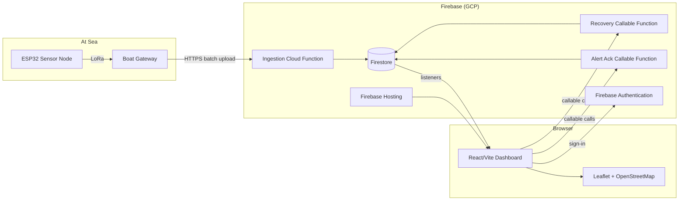

**Subsystem responsibilities**

- **ESP32 Sensor Node:** samples GPS, battery, and signal quality; transmits over LoRa. Out of scope for the web app, but its payload shape constrains the telemetry schema (§7, §10).
- **Boat Gateway:** aggregates LoRa packets from nearby nets, batches them, and pushes to the ingestion endpoint over HTTPS using its own gateway credential (never a browser credential).
- **Ingestion Cloud Function:** validates and normalizes incoming batches, writes telemetry history and updates the denormalized "latest state" on the net document.
- **Firestore:** system of record for organizations, nets, telemetry, and audit events; also the real-time transport to the browser via listeners.
- **Recovery / Alert-Ack Callable Functions:** the only path by which the dashboard can change authoritative net state; enforce membership, role, and business validation before writing.
- **React Dashboard:** renders Overview, Net Detail, Devices, and Settings; subscribes to Firestore; calls Callable Functions; never writes net/telemetry documents directly.
- **Leaflet/OpenStreetMap:** presentation-only map layer; always backed by the same data as the list view, never an independent data source.

---

## 4. High-Level Component Diagram

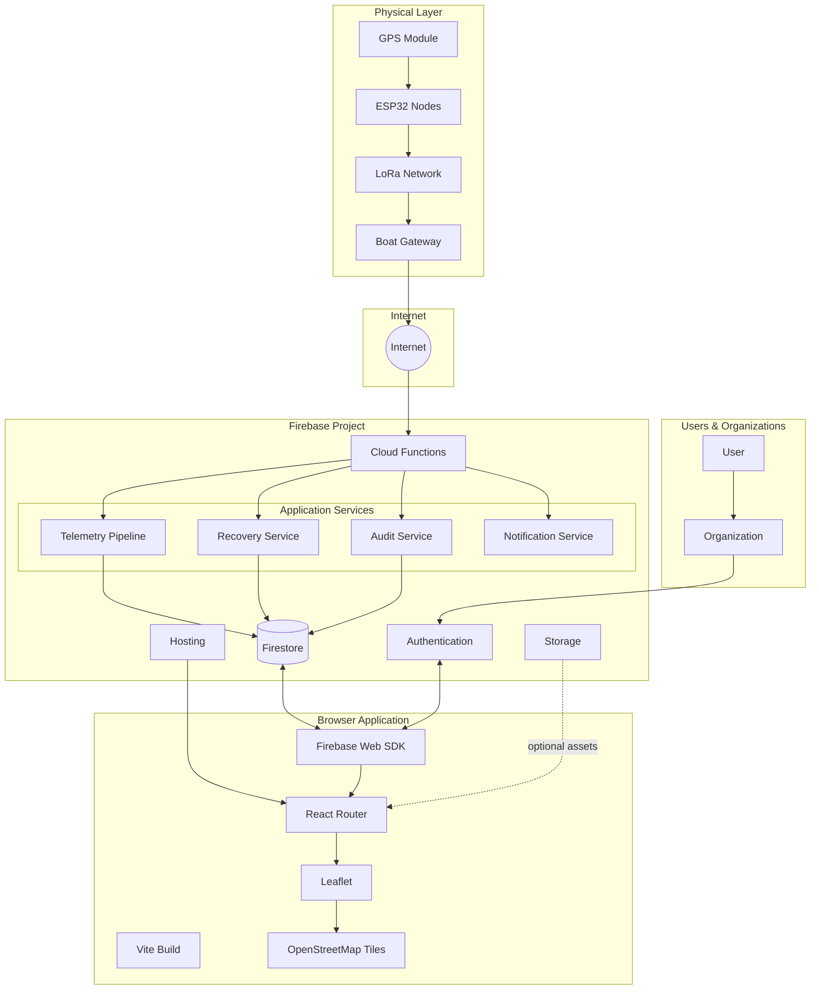

Note on **Storage**: not required by the current MVP checklist (no file uploads are described), but reserved for future device firmware artifacts, exported reports, or net photos (§24).

---

## 5. Frontend Architecture

**Folder structure philosophy:** feature-based, matching the checklist's proposed layout (`src/features/{auth,nets,recovery}`), extended for production concerns:

- `src/app` — app shell, router, providers, top-level error boundary.
- `src/features/auth` — sign-in screen, auth context/hook, route guards.
- `src/features/nets` — Overview + Net Detail pages, net list/search/filter/sort logic, telemetry history view.
- `src/features/recovery` — confirmation modal, recovery hook calling the Callable Function, optimistic-on-success UI state.
- `src/features/devices` — placeholder feature module for device diagnostics (future, structurally present now).
- `src/features/settings` — organization/user settings.
- `src/map` — Leaflet wrapper components, marker rendering, marker click → detail navigation.
- `src/components` — shared, dumb UI components (Button, Card, Badge, Modal, Skeleton, EmptyState, ErrorState).
- `src/services/firebase` — thin wrappers around Firebase SDK (auth service, Firestore query service, callable-function service). This is the **only** place `firebase/*` imports are allowed outside of `src/app` bootstrap.
- `src/context` — `OrgContext`, `AuthContext`.
- `src/hooks` — cross-feature hooks (`useNetsForOrg`, `useNetDetail`, `useStaleness`).
- `src/lib` — pure utilities (staleness calculation, formatting, freshness thresholds).

**Routing:** React Router with route groups: `/sign-in` (public), and a protected layout route wrapping `/overview`, `/nets/:netId`, `/devices`, `/settings`. Protected layout mounts `OrgProvider` after auth resolves.

**State management:** local component state + React Context for cross-cutting concerns (auth identity, active organization). Firestore listeners are the source of truth for server data — there is deliberately **no separate client-side global store duplicating Firestore state** (e.g., no Redux mirroring Firestore); this avoids a whole class of sync bugs. Server data lives in hooks backed by `onSnapshot`; only *derived UI state* (modal open/closed, selected filters) lives in component state.

**Authentication flow:** `AuthProvider` listens to `onAuthStateChanged`; while resolving, the app shows a loading shell; once resolved, unauthenticated users are redirected to `/sign-in`; authenticated users proceed to organization resolution.

**Protected routes / organization context:** a route guard checks (1) is the user authenticated, (2) does the user have at least one organization membership. A user with zero or an invalid organization sees a dedicated "no organization" state rather than a blank/broken dashboard — this was explicitly called out as a required edge case in the checklist.

**Error boundaries:** one top-level boundary catches render-time crashes; feature-level boundaries around Map and Telemetry History so a failure in one widget (e.g., a bad map tile config) doesn't blank the whole page.

**Loading/empty states:** every data-bearing component has three explicit render branches — loading (skeleton), empty (friendly "no nets yet" / "no telemetry yet"), and error (retry affordance) — never a bare spinner-forever or blank screen.

**Service/API layer:** `services/firebase/nets.ts` exposes `subscribeToOrgNets(orgId, cb)`, `subscribeToNetDetail(orgId, netId, cb)`, `getTelemetryPage(...)`; `services/firebase/recovery.ts` exposes `recoverNet(netId)` and `acknowledgeAlert(alertId)`, both calling `httpsCallable`. Components never call Firestore or Functions directly.

**Map rendering:** `src/map/NetMarker.tsx` renders one marker per net from the *same* `latest` state object used by the list; clicking a marker navigates to `/nets/:netId`.

**Search/filter/sort:** client-side over the currently-subscribed org net list (expected to be at most a few hundred to low-thousands of nets per org — see §20 for the pagination path once that assumption breaks).

**Performance:** route-based code splitting (`React.lazy` per top-level route), list virtualization for telemetry history once it exceeds a page, memoized selectors for filtered/sorted net lists, and image/tile lazy loading from Leaflet itself.

**Offline/real-time:** Firestore's IndexedDB persistence is enabled; the app tags all rendered data with a "from cache" flag surfaced from Firestore's snapshot metadata (`snapshot.metadata.fromCache`) and reflects it in the UI badge (§13).

---

## 6. Backend Architecture

The backend is 100% serverless: Cloud Functions (2nd gen) plus Firestore, no custom servers.

**Function inventory**

| Function | Trigger | Purpose |
|---|---|---|
| `ingestTelemetry` | HTTPS (gateway calls directly, authenticated by gateway API key/service credential, **not** Firebase Auth) | Validates a telemetry batch, writes telemetry subcollection docs, updates denormalized `latest` state on the net doc. |
| `recoverNet` | Callable (Firebase Auth required) | Validates caller's org membership and role, marks a net recovered, writes an audit event. |
| `acknowledgeAlert` | Callable (Firebase Auth required) | Validates membership, marks alert acknowledged, writes an audit event. |
| `onNetWrite` (future) | Firestore trigger on net doc write | Evaluates alert conditions (e.g., crossed stale threshold) and creates alert documents / notification jobs. |
| `staleSweep` (scheduled) | Cloud Scheduler → Pub/Sub → Function | Periodically recomputes staleness flags so status isn't purely computed client-side (defense in depth; see §13). |

**Data validation:** every callable function validates its input against an explicit schema (shape, types, ID existence) before touching Firestore, and re-derives authorization from `organizations/{orgId}/members/{uid}` rather than trusting client-supplied role claims.

**Audit logging:** every mutating function writes an `auditEvents/{eventId}` document capturing actor uid, org, action, target, timestamp, and result — this is the backend counterpart to the UI's "success or failure result" requirement in the checklist, and the basis for the audit trail referenced throughout.

**Error handling:** Callable Functions throw `HttpsError` with a stable `code` (`permission-denied`, `not-found`, `failed-precondition`) and a human-readable message; the frontend maps these codes to friendly copy rather than displaying raw errors.

**Recovery logic:** `recoverNet` is idempotent — recovering an already-recovered net is a no-op success, not an error, so a retried request (e.g., after a flaky network) can't corrupt state or double-log.

**Rate limiting / retry / dead-letter:** `ingestTelemetry` applies per-gateway rate limiting (reject with 429 above a configured batch rate) and writes malformed batches to a `deadLetter/telemetry/{id}` collection with the raw payload and validation error, instead of dropping them — this preserves debuggability without blocking the ingestion pipeline.

---

## 7. Firestore Architecture

**Collection design**

```
users/{uid}
organizations/{orgId}
organizations/{orgId}/members/{uid}
organizations/{orgId}/nets/{netId}
organizations/{orgId}/nets/{netId}/telemetry/{eventId}
organizations/{orgId}/gateways/{gatewayId}
organizations/{orgId}/alerts/{alertId}
organizations/{orgId}/auditEvents/{eventId}
```

**`nets/{netId}` shape (denormalized latest state):**

```json
{
  "name": "Net A-14",
  "status": "deployed | stale | recovered",
  "latest": {
    "lat": 12.345,
    "lng": 45.678,
    "batteryPct": 71,
    "signal": "good | fair | poor",
    "recordedAt": "<device timestamp>"
  },
  "lastReceivedAt": "<server timestamp, set by ingestTelemetry>",
  "updatedAt": "<server timestamp>",
  "gatewayId": "gw_123"
}
```

**Why denormalize `latest` onto the net document:** the Overview page needs one document per net, in one query, to render list + map. If the "current state" required reading the newest telemetry subcollection doc for every net, the Overview page would need N extra queries (one per net) — this doesn't scale past a handful of nets. Storing `latest`/`lastReceivedAt`/`status` directly on the net document means Overview is a single `where(orgId==...)` collection query, and the telemetry subcollection exists purely for history/detail pagination. This is a deliberate normalization trade-off: slightly more complex writes (the ingestion function must update two places atomically) for dramatically simpler, cheaper, and more scalable reads.

**Timestamps:** `lastReceivedAt` and `updatedAt` are Firestore server timestamps (set with `FieldValue.serverTimestamp()` inside the ingestion function) — staleness must never be computed from a device or client clock, only from the server-observed receipt time, per the checklist's freshness requirement.

**Indexes:** composite index on `nets` for `(status, lastReceivedAt desc)` to support "show stale nets first" sorting; single-field index on `telemetry.recordedAt desc` for paginated history reads.

**Security implications & tenant isolation:** every readable/writable path under `organizations/{orgId}/...` is gated by rules that check `exists(/databases/$(db)/documents/organizations/$(orgId)/members/$(request.auth.uid))`. There is no top-level collection a member of Org A could scan to see Org B's nets — org scoping is structural (subcollection path), not just a filtered query, which means even a buggy client query can't leak cross-tenant data.

**Retention/TTL:** telemetry events older than the configured retention window (e.g., 18 months) are candidates for a scheduled cleanup function or Firestore TTL policy field (`expireAt`) to bound storage growth as fleets scale (§20).

**Read/write patterns:** Overview = 1 listener per org on `nets`. Net Detail = 1 listener on the net doc + 1 paginated query on `telemetry`. Writes are almost entirely server-side (Cloud Functions using the Admin SDK), keeping the client's Firestore permission surface nearly read-only, which is the simplest possible rule set to reason about and audit.

---

## 8. Authentication Architecture

Firebase Authentication is the single identity provider. Sign-in method is MVP-selectable (email/password or an OAuth provider) but the architecture is provider-agnostic above the `AuthProvider` boundary.

**JWT lifecycle:** Firebase Auth issues a short-lived ID token (1 hour) plus a refresh token managed transparently by the SDK; the SDK auto-refreshes the ID token before expiry, and every Firestore/Callable-Function request is authenticated with the current ID token automatically — the app code never manually manages tokens.

**Session handling:** `onAuthStateChanged` is the single source of truth for "is someone signed in"; the app never persists its own parallel session/localStorage boolean, avoiding a class of stale-session bugs.

**Organization context & authorization:** the ID token itself only proves *identity*, not org membership or role. Role/membership is authorized per-request by Security Rules and Cloud Functions reading `organizations/{orgId}/members/{uid}` documents — this keeps role changes effective immediately (no waiting for a custom-claims token refresh) at the cost of one extra document read per rule evaluation, which Firestore Rules perform efficiently.

**Route guards:** implemented as a wrapper component that (1) blocks until auth state resolves, (2) redirects unauthenticated users to `/sign-in`, (3) blocks until org membership resolves, (4) renders a dedicated screen for zero/invalid org context.

**Logout flow:** `signOut()` clears the Firebase Auth session; all active Firestore listeners are explicitly unsubscribed in a cleanup effect tied to the auth state transition, so no stale listener keeps streaming another user's data after logout on a shared device.

---

## 9. Security Architecture

**Threat model (summary):** the main risks are (1) cross-tenant data leakage, (2) unauthorized recovery/alert-ack mutations, (3) gateway credential compromise, (4) malformed/malicious telemetry payloads, (5) standard web app risks (XSS/CSRF/injection) on the dashboard itself.

- **Multi-tenancy:** enforced structurally via subcollection paths + rules (see §7), not by client-side filtering. Rules are covered by an emulator test suite that explicitly asserts Org A cannot read/write Org B's `nets`, `telemetry`, or `auditEvents`.
- **Secrets management:** the browser only ever holds the public Firebase Web config (API key, authDomain, projectId, etc.) — these are not secrets in the traditional sense (they identify the project, not authorize access; access is authorized by Rules). The Boat Gateway's credential and any privileged service account key never ship to the client and live only in the gateway's own secure config / Cloud Functions runtime.
- **Least privilege:** client Firestore permissions are read-mostly; all sensitive writes are Admin-SDK-only, invoked through Callable Functions, so a compromised or buggy client can't write to `status`, `auditEvents`, or another org's data even if a rule had a gap in defense-in-depth.
- **Input validation:** every Callable Function validates shape/type/ID-existence server-side before writing; `ingestTelemetry` rejects out-of-range GPS/battery values rather than storing garbage.
- **Replay protection & rate limiting:** ingestion enforces per-gateway rate limits; recovery/ack functions are idempotent (§6) so replays are harmless rather than requiring nonce tracking.
- **XSS:** React's default escaping is relied on; no `dangerouslySetInnerHTML` for any server- or device-sourced string (net names, alert text).
- **CSRF:** not applicable in the traditional cookie-session sense — Firebase Auth uses bearer ID tokens attached per-request by the SDK, not ambient cookies, which removes most classic CSRF vectors; Cloud Functions still validate the token's audience/issuer.
- **CSP / secure headers / HTTPS:** Firebase Hosting serves over HTTPS by default; a Content-Security-Policy is configured to allow only Firebase, OpenStreetMap tile, and self origins, blocking arbitrary third-party script injection.
- **Dependency security:** CI runs `npm audit`/Dependabot-equivalent scanning on every PR.
- **OWASP Top 10:** mapped throughout — broken access control (§7/§9 tenancy), cryptographic failures (TLS everywhere, no custom crypto), injection (typed validation, no string-built queries), insecure design (server-authoritative mutations), security logging (audit events).

---

## 10. Telemetry Pipeline

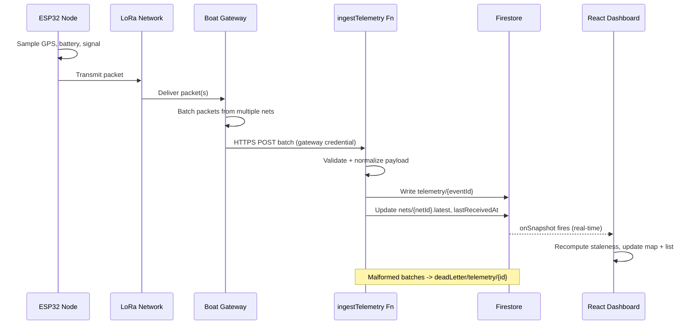

Each stage has a distinct responsibility: the ESP32 only samples and transmits; the Boat Gateway only aggregates and forwards (it holds no business logic about staleness or alerts — that lives entirely server-side so it can't drift between gateway firmware versions); `ingestTelemetry` is the single choke point where payload validation, normalization, and the two-write update (history + denormalized latest) happen atomically; Firestore listeners then push the update to every connected dashboard for that org in near real time; the React UI recomputes staleness client-side for immediate feedback but treats the server-side `staleSweep` (§6) as the authoritative periodic re-check, so a client that's been open for hours without new telemetry still correctly flips to "stale."

---

## 11. Map Architecture

- **Library:** Leaflet + OpenStreetMap tiles (no paid tile provider dependency, keeps costs at zero for the MVP).
- **Marker rendering:** one marker per net, driven by the same `latest.lat/lng` field used in the list view — never a separate "map data" fetch, which is what guarantees list/map consistency required by the checklist.
- **Marker clustering:** reserved for when an organization's net count makes individual markers visually unusable (roughly >150–200 nets in one viewport); implemented with a clustering plugin rather than custom logic.
- **Interaction:** clicking a marker navigates to `/nets/:netId`; hover/tooltip shows name + status without needing a full page navigation.
- **History visualization:** the Net Detail page can optionally render the last N telemetry points as a polyline/track on a smaller map, using the paginated telemetry query — not a live "trail" that grows unbounded.
- **Performance:** markers are only rendered for nets in the currently subscribed org (not global), and clustering avoids re-rendering hundreds of DOM/canvas nodes per pan/zoom.
- **Viewport management:** initial map bounds auto-fit to the org's nets; user pan/zoom state is local and not persisted server-side.
- **Offline behavior:** OpenStreetMap tiles are not cached for offline use in the MVP (this is called out as a known limitation, not silently hidden) — the map degrades to a blank/grey tile background while the list view (backed by Firestore's local cache) keeps working, satisfying the "map is not the only source of truth" requirement even when the network is degraded.

---

## 12. Recovery Workflow

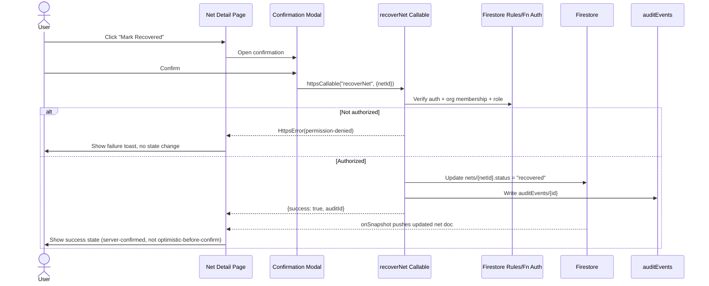

Per the checklist, the UI update is **success-based, not pre-emptively optimistic** — the confirmation modal blocks until the Cloud Function actually returns, and only then does the UI reflect "recovered." This intentionally trades a few hundred milliseconds of perceived speed for the guarantee that the dashboard never shows a recovery that the server rejected. Failures render an explicit failure state with the reason (e.g., "you don't have permission" vs. "network error, try again") rather than silently reverting an optimistic change.

---

## 13. Real-Time Data Architecture

- **Subscription lifecycle:** each page mounts exactly the listeners it needs (Overview → org nets collection; Net Detail → single net doc + paginated telemetry) inside a `useEffect`, and unsubscribes on unmount or org/route change — a listener leak checklist item explicitly called out.
- **Cache & offline persistence:** Firestore's IndexedDB persistence is enabled once at app bootstrap; reads are served from cache instantly while a fresh read is in flight, and `snapshot.metadata.fromCache` is threaded through the data hooks into a UI badge ("showing cached data") rather than being silently swallowed.
- **Synchronization / conflict handling:** because clients never write net/telemetry documents directly (§6, §9), there is no client-side write conflict to resolve — all writes originate from one authoritative Cloud Function invocation at a time, so "last write wins" conflicts are a non-issue by construction.
- **Event propagation:** a single `ingestTelemetry` write fans out to every subscribed dashboard for that org via Firestore's native listener infrastructure — no custom WebSocket/pub-sub layer is needed.
- **Stale detection:** computed client-side from `lastReceivedAt` against a configurable freshness threshold (e.g., 30 minutes), re-evaluated on a timer (so a net doesn't visually stay "fresh" forever just because no new snapshot arrived), and cross-checked by the server-side `staleSweep` function which can flip `status` authoritatively even if no client is currently open.

---

## 14. UI Architecture

- **Overview:** net list (search/filter/sort) + map, status cards summarizing counts (fresh/stale/recovered).
- **Net Detail:** identity + status header, battery/signal cards, small map of latest fix, paginated telemetry history table, recovery action.
- **Devices:** structural placeholder in the MVP navigation for future gateway/device diagnostics (§24), keeping the nav and routing shape stable so it can be filled in without restructuring.
- **Settings:** organization/user-level settings (initially minimal — org name, membership list read-only view).
- **Navigation:** persistent top or side nav with Overview / Net Detail (contextual) / Devices / Settings, collapsing to a bottom or hamburger nav on mobile widths.
- **Cards, tables, dialogs, notifications:** a small shared component set (`Card`, `Badge`, `Table`, `Modal`, `Toast`) used consistently so status semantics (fresh/stale/low-battery/recovered) are visually uniform across every screen.
- **Dark mode:** deferred but structurally trivial given CSS-variable-based theming (no hardcoded colors in components).
- **Accessibility/keyboard nav:** every interactive element is a real `button`/`a`/form control (no click-only `div`s), focus order follows visual order, and the recovery confirmation modal traps focus while open.

---

## 15. Deployment Architecture

**Environments:** Development (local + Firebase emulators) → Testing (CI, emulator suite) → Staging (dedicated Firebase project or environment) → Production (Firebase Hosting + production Firebase project).

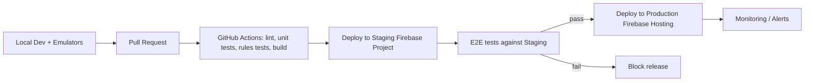

- **CI/CD:** GitHub Actions pipeline: install → lint → unit tests → Firestore emulator rules tests → build → deploy (staging automatically on merge to `main`, production via a manual/tagged release step).
- **Environment variables:** distinct `.env.staging` / `.env.production` files (Firebase config per project) injected at build time; never committed with real values, documented via `.env.example`.
- **Versioning & rollback:** Firebase Hosting's built-in release history allows one-command rollback to a prior deploy; Cloud Functions are versioned per deploy and can similarly be rolled back.
- **Monitoring/logging:** Cloud Functions logs to Cloud Logging by default; Hosting/Firestore usage visible in the Firebase console; recommend adding a crash-reporting SDK (e.g., Sentry) for the frontend in production.

---

## 16. Folder Structure

```
smartnet-dashboard/
├── .github/workflows/ci.yml
├── .env.example
├── firebase.json
├── firestore.rules
├── firestore.indexes.json
├── functions/
│   ├── src/
│   │   ├── index.ts
│   │   ├── telemetry/ingestTelemetry.ts
│   │   ├── recovery/recoverNet.ts
│   │   ├── alerts/acknowledgeAlert.ts
│   │   ├── alerts/onNetWrite.ts
│   │   ├── scheduled/staleSweep.ts
│   │   ├── shared/validation.ts
│   │   ├── shared/audit.ts
│   │   └── shared/authz.ts
│   └── test/
├── src/
│   ├── app/
│   │   ├── App.tsx
│   │   ├── router.tsx
│   │   ├── providers.tsx
│   │   └── ErrorBoundary.tsx
│   ├── features/
│   │   ├── auth/
│   │   │   ├── SignInPage.tsx
│   │   │   ├── useAuth.ts
│   │   │   └── RouteGuard.tsx
│   │   ├── nets/
│   │   │   ├── OverviewPage.tsx
│   │   │   ├── NetDetailPage.tsx
│   │   │   ├── useNetsForOrg.ts
│   │   │   ├── useNetDetail.ts
│   │   │   └── TelemetryHistoryTable.tsx
│   │   ├── recovery/
│   │   │   ├── RecoveryButton.tsx
│   │   │   ├── RecoveryConfirmModal.tsx
│   │   │   └── useRecoverNet.ts
│   │   ├── devices/DevicesPage.tsx
│   │   └── settings/SettingsPage.tsx
│   ├── map/
│   │   ├── MapView.tsx
│   │   ├── NetMarker.tsx
│   │   └── clustering.ts
│   ├── components/
│   │   ├── Card.tsx, Badge.tsx, Table.tsx, Modal.tsx, Toast.tsx
│   │   ├── SkeletonLoader.tsx, EmptyState.tsx, ErrorState.tsx
│   ├── context/
│   │   ├── AuthContext.tsx
│   │   └── OrgContext.tsx
│   ├── services/firebase/
│   │   ├── config.ts
│   │   ├── auth.ts
│   │   ├── nets.ts
│   │   ├── telemetry.ts
│   │   └── recovery.ts
│   ├── lib/
│   │   ├── staleness.ts
│   │   └── formatting.ts
│   ├── hooks/useStaleness.ts
│   └── main.tsx
├── e2e/ (Playwright/Cypress specs)
└── vite.config.ts
```

---

## 17. Sequence Diagrams

**Login**
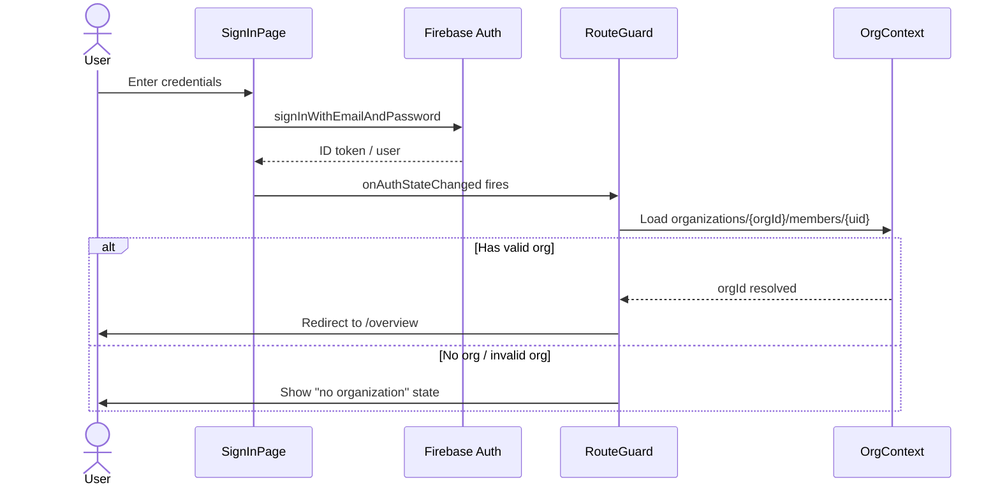

**Dashboard loading (Overview)**
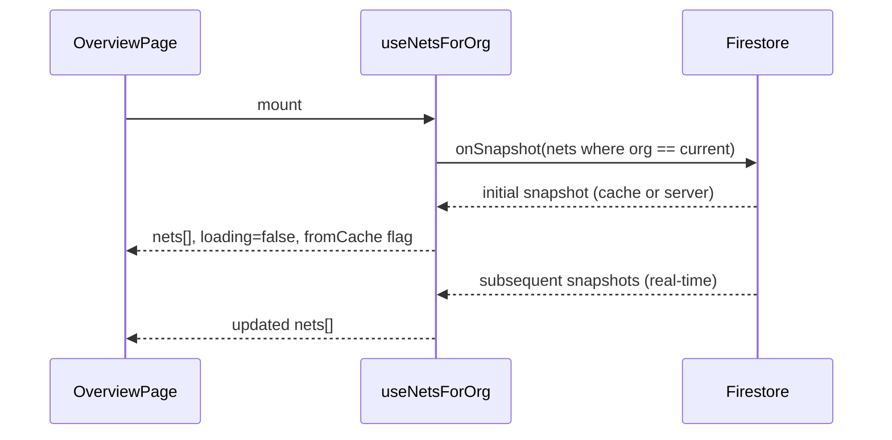

**Alert acknowledgement**
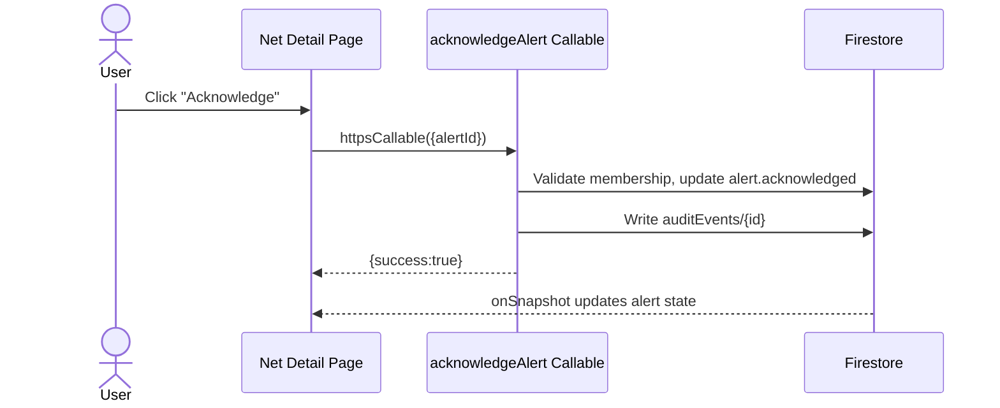

*(Telemetry upload and Recovery sequence diagrams are provided in §10 and §12 respectively; Real-time update propagation is covered structurally in §13.)*

---

## 18. Data Flow Diagrams

**DFD Level 0 (Context)**
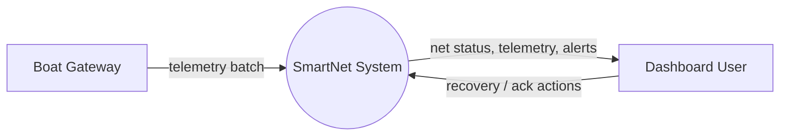

**DFD Level 1 (Major processes)**
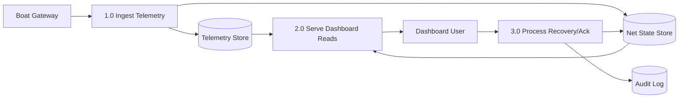

**DFD Level 2 (Ingest Telemetry detail)**
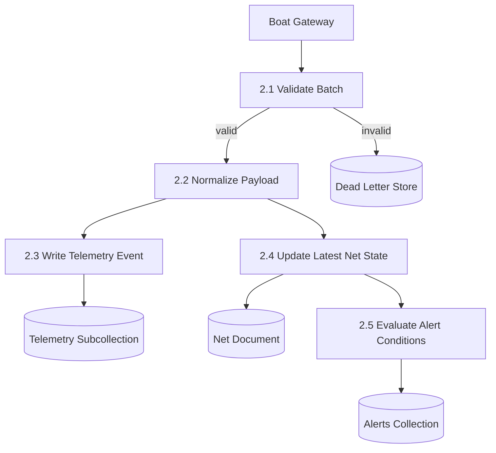

---

## 19. API Interaction Diagrams

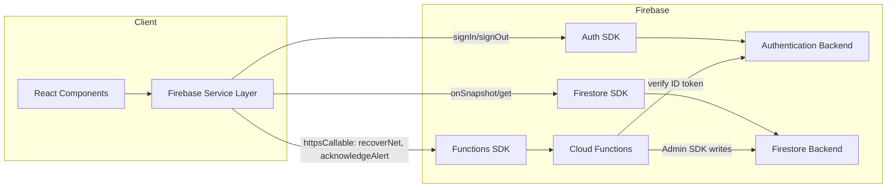

---

## 20. Scalability Strategy

- **Thousands of nets / millions of telemetry records:** the `telemetry` subcollection per net keeps individual query scopes small regardless of total system size (a query for one net's history never scans another net's data); composite indexes keep the "sort by recency" queries cheap at scale.
- **Large organizations:** once a single org's net count makes an unpaginated `onSnapshot` on the whole `nets` collection expensive, introduce pagination (`limit` + `startAfter`) or a `status`-scoped default view (e.g., "stale nets" first, "load more" for the rest) instead of always fetching everything.
- **Caching:** Firestore's own client cache absorbs most repeat-read cost; a CDN in front of Hosting caches static assets.
- **Firestore optimization:** keep documents small (denormalized `latest` object is a handful of fields, not the whole telemetry history), avoid unindexed compound queries, use TTL/retention (§7) to bound telemetry growth.
- **Cloud Function scaling:** functions are stateless and horizontally auto-scaled by the platform; ingestion is the highest-throughput path, so it's the one function budgeted for concurrency/rate-limit tuning first.
- **Cost optimization:** serverless-by-default means near-zero cost at low usage; the main future cost driver is telemetry read/write volume, which is why retention/TTL (§7) and denormalization (§7) are treated as scalability *and* cost decisions, not just performance ones.

---

## 21. Reliability Strategy

| Failure scenario | Behavior |
|---|---|
| Boat Gateway offline | Nets under that gateway simply stop receiving updates; `lastReceivedAt` ages, staleness flips visibly — this is treated as expected, visible degradation, not a system failure. |
| Network failure (client) | Firestore cache continues serving last-known reads; UI shows a "cached / offline" indicator; mutating actions (recovery) are disabled or clearly marked as requiring connectivity. |
| Firestore unavailable | The Firebase SDK retries transparently; the dashboard shows a global error/retry state if reads truly cannot complete, rather than an infinite spinner. |
| Partial telemetry batch failure | Ingestion processes records independently within a batch where possible; failed records go to the dead-letter store (§6) instead of failing the whole batch silently. |
| Recovery/ack retry | Both functions are idempotent (§6, §12), so client-side retry logic (e.g., after a timeout) is always safe. |
| Repeated ingestion failures from one gateway | Rate limiting plus dead-letter accumulation gives an operational signal (visible in Cloud Logging/monitoring) that a specific gateway needs attention, functioning as a lightweight circuit breaker. |

---

## 22. Performance Optimization

- Route-based code splitting so Settings/Devices code isn't loaded until visited.
- Virtualized telemetry history list/table once history exceeds a page.
- Memoized derived selectors for filtered/sorted net lists so re-renders don't re-sort on every keystroke.
- Firestore query optimization: only fields needed for list rendering are read (the denormalized `latest` object, not full telemetry history) on the Overview page.
- Leaflet marker clustering to avoid excessive DOM/canvas nodes at scale (§11).
- Bundle optimization via Vite's production build (tree-shaking, minification) and dependency budget review in CI.

---

## 23. Monitoring & Observability

- **Structured logs:** every Cloud Function logs a structured entry (function name, orgId, actor uid, outcome) to Cloud Logging.
- **Audit logs:** `auditEvents` collection is the durable, queryable record of every sensitive action (§6, §9), usable both operationally and for customer support/dispute resolution.
- **Crash reporting:** frontend integrates a crash-reporting SDK in production to catch render-time errors that reach the top-level boundary.
- **Performance metrics:** Firebase Performance Monitoring (or equivalent) tracks page load and Firestore listener latency.
- **Health dashboards:** a lightweight internal dashboard (or Cloud Monitoring dashboard) tracks ingestion throughput, dead-letter rate, and function error rate per gateway/org.
- **Alerts:** Cloud Monitoring alert policies on elevated Cloud Function error rates or ingestion dead-letter spikes, notifying the engineering/ops team (distinct from in-app user-facing alerts).

---

## 24. Future Architecture

The current data model and function boundaries are deliberately chosen so these can be added without a rewrite:

- **AI prediction / analytics:** telemetry history is already a clean, indexed time series per net — a future batch job or BigQuery export (Firestore → BigQuery extension) can feed drift/loss-prediction models without touching the live ingestion path.
- **Weather / satellite imagery integration:** additive fields on the net document or a new `environmentalContext` subcollection, joined by location/time — no change to existing collections required.
- **Mobile application:** the same Firebase Auth, Firestore, and Callable Function contracts are directly reusable from a React Native or native client; the "thin authoritative-server" design (§1, §9) means no new backend surface is needed, only a new client.
- **IoT fleet management / device diagnostics:** the `Devices` nav placeholder (§14) and the `gateways/{gatewayId}` collection (§7) already provide the structural seam.
- **Push/SMS/email notifications:** the `onNetWrite`/alert-evaluation function (§6) already produces alert documents; a notification dispatch function can subscribe to new alerts and fan out via FCM/SMS/email providers without changing how alerts are created.
- **Role expansion:** the membership-document-based authorization model (§8) can add a `role` field per member today's rules already read the membership doc, so adding role checks is additive, not a redesign.
- **Further API integrations:** the Callable Function boundary (§6) is the natural integration point for any future partner API, keeping third-party coupling out of the Firestore data model itself.

---

*End of document.*
