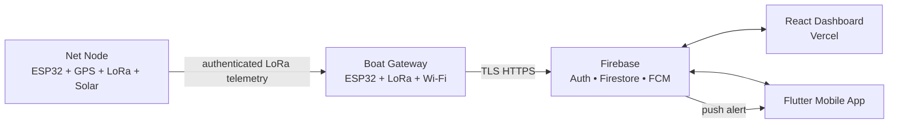
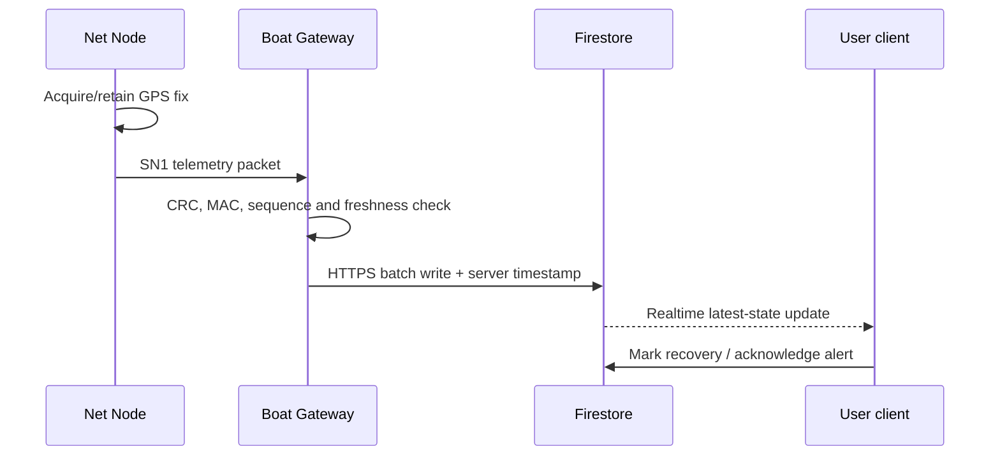

# SmartNet — System Architecture

| Field | Value |
|---|---|
| Document ID | SN-ARC-001 |
| Version | 1.0 |
| Status | Normative |

## Purpose

Specify system components, boundaries, data flows, and principal design decisions.

## Scope

MVP physical, firmware, cloud, web, and mobile architecture.

## Audience

Implementers, reviewers, QA, and security engineers.

## Dependencies

[Protocol](04_Communication_Protocol.md), [database](05_Database_Design.md), [security](07_Security.md).

## References

C4 model; Firebase security rules documentation; ESP32 and SX127x datasheets.

## Revision history

| Version | Date | Change |
|---|---|---|
| 1.0 | 2026-07-14 | Initial architecture |

## Table of contents

- [Architecture](#architecture)
- [Responsibilities](#responsibilities)
- [Data flow](#data-flow)
- [Decisions](#decisions)
- [Failure behavior](#failure-behavior)

## Architecture

## Responsibilities

| Component | Owns | Must not own |
|---|---|---|
| Net Node | Fix acquisition, energy-aware packet transmission | User identity or cloud credentials |
| Boat Gateway | Packet verification, de-duplication, durable upload queue | Authoritative UI business logic |
| Firebase | Identity, tenant authorization, telemetry persistence, notifications | LoRa device control loop |
| Clients | Visualization, operator actions, offline read cache | Direct device communication |

## Data flow

## Decisions

| Decision | Rationale | Consequence |
|---|---|---|
| Gateway is cloud writer | Node has no Wi-Fi and avoids cloud secrets | Gateway must queue offline writes |
| Firestore stores latest + history | Cheap current map query and audit trail | Retention job required after MVP scale |
| Shared protocol version `SN1` | Enables independent firmware changes | Breaking changes require version bump |
| Owner/organization document boundary | Straightforward authorization query | Cross-tenant analytics is excluded |

## Failure behavior

The Node stores no unbounded history: it retries a packet with bounded exponential backoff, then sleeps. Gateway stores a bounded FIFO queue in NVS; on overflow it retains the newest latest-state packet and records a diagnostic event. Clients display stale data based on `lastReceivedAt`, never infer a live position from an old fix.
