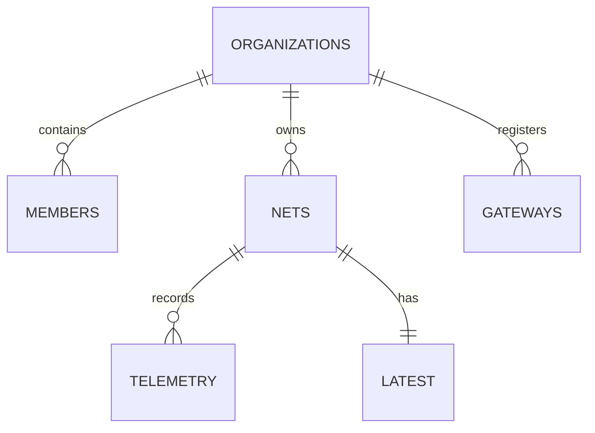

# SmartNet — Database Design

| Field | Value |
|---|---|
| Document ID | SN-DB-001 |
| Version | 1.0 |
## Purpose
Define Firestore persistence, relationships, queries, validation, and retention.
## Scope
Firebase Authentication, Firestore, Storage, and FCM references.
## Audience
Backend, client, QA, and security engineers.
## Dependencies
[API](06_API_Design.md), [security](07_Security.md).
## References
Firestore data-model and security-rules documentation.
## Revision history
| Version | Date | Change |
|---|---|---|
| 1.0 | 2026-07-14 | Initial model |
## Table of contents
- [Model](#model)
- [Schemas](#schemas)
- [Indexes and queries](#indexes-and-queries)
- [Offline and scaling](#offline-and-scaling)

## Model

## Schemas

| Path | Required fields | Notes |
|---|---|---|
| `users/{uid}` | `displayName`, `email`, `activeOrgId`, `createdAt` | User profile; no authorization source alone |
| `organizations/{orgId}` | `name`, `createdAt` | Tenant root |
| `organizations/{orgId}/members/{uid}` | `role: admin|operator|viewer`, `createdAt` | Authorization document |
| `organizations/{orgId}/nets/{netId}` | `nodeId`, `name`, `status`, `latest`, `lastReceivedAt`, `updatedAt` | Current-map query document |
| `.../nets/{netId}/telemetry/{eventId}` | `receivedAt`, `fixAt`, `location`, `batteryMv`, `seq`, `gatewayId`, `rssi`, `snr` | Immutable event; gateway-only write |
| `.../gateways/{gatewayId}` | `name`, `status`, `lastSeenAt`, `deviceKeyRef` | Never store secret material |
| `.../audit/{auditId}` | `actorUid`, `action`, `targetPath`, `at` | Append-only audit trail |

`latest.location` is a GeoPoint, `latest.fixAt` is a Timestamp, and `lastReceivedAt` is server controlled. Client-generated recovery action may change only `status`, `recoveredAt`, and permitted notes through a callable function or restricted rule.

## Indexes and queries

Create composite index on nets: `status ASC, lastReceivedAt DESC`; telemetry: `receivedAt DESC`; audit: `at DESC`. Dashboard queries only its single organization path, limits telemetry history to 100 events, and paginates with document cursors. Do not run unbounded collection-group queries in the free-tier MVP.

## Offline and scaling

Firestore SDK persistence caches client reads/writes; UI must label cached/offline results and resolve server rejections. Gateway uses an HTTP queue, not Firestore offline SDK. Store latest state separately to avoid map queries scanning history. Apply retention (e.g., 90 days telemetry) with a scheduled function only after quotas/billing support it; deletion must preserve aggregate incident data when required.
