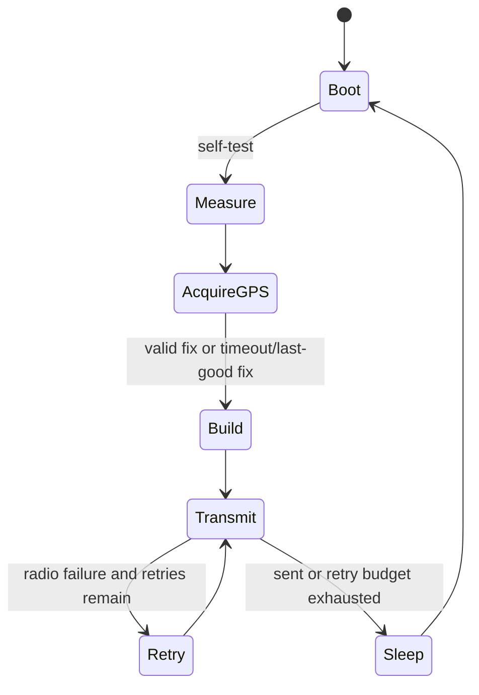

# SmartNet Net Node Firmware Architecture

| Field | Value |
|---|---|
| Version | 1.0 |
| Owner | Embedded engineering |
## Purpose
Implement a solar-powered ESP32 buoy that emits signed location/health telemetry.
## Scope
Arduino framework, GPS, LoRa, power, diagnostics; cloud/UI excluded.
## Audience
Embedded, hardware, QA.
## Dependencies
[Protocol](../../docs/04_Communication_Protocol.md), [BOM](../../docs/03_Bill_of_Materials.md).
## References
ESP32 deep-sleep, TinyGPS++, SX127x datasheets.
## Revision history
| Version | Date | Change |
|---|---|---|
| 1.0 | 2026-07-14 | MVP behavior |
## Table of contents
- [Structure](#structure)
- [State machine](#state-machine)
- [Power and recovery](#power-and-recovery)

## Structure
```text
firmware/net-node/src/{main.cpp,config.h,gps.cpp,lora.cpp,power.cpp,packet.cpp,storage.cpp}/
```

## State machine


## Power and recovery

Boot reads reset reason, NVS sequence/last-good fix, battery ADC, then initializes GPS and radio only when needed. GPS acquisition has a configurable timeout; invalid fix sets flag and preserves last good coordinates only if explicitly marked stale. Default report interval is 10 min; low battery extends interval and disables nonessential diagnostics. GPIO leakage must be measured, peripherals powered down, and wake timer configured before deep sleep.

Validate configuration at compile/provision time; never log MAC keys. Watchdog covers awake work and resets to a safe sleep path. LoRa transmission uses bounded retries (30/120 s); no downlink or OTA in MVP. Future OTA requires signed image, rollback, battery threshold, and radio/cellular transport design.
