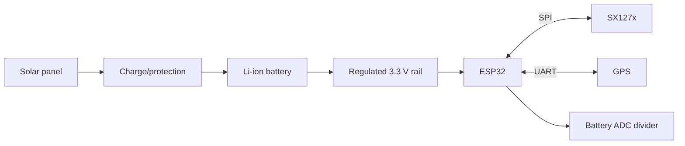

# SmartNet Schematics Architecture

| Field | Value |
|---|---|
| Version | 1.0 |
## Purpose
Define electrical blocks, pin ownership, protection, and prototype wiring constraints.
## Scope
Net Node and Gateway electrical integration; final custom PCB is future work.
## Audience
Hardware, firmware, technicians, QA.
## Dependencies
[BOM](../../docs/03_Bill_of_Materials.md), [PCB](../PCB/ARCHITECTURE.md).
## References
ESP32, SX127x, NEO-6M, TP4056 module datasheets.
## Revision history
| Version | Date | Change |
|---|---|---|
| 1.0 | 2026-07-14 | Prototype electrical design |
## Table of contents
- [Blocks](#blocks)
- [Pinout](#pinout)
- [Safety](#safety)

## Blocks

## Pinout

Pin assignment is configuration-controlled and must be finalized against the selected ESP32 board. Required interfaces: LoRa SPI (`SCK`, `MISO`, `MOSI`, `NSS`, `DIO0`, `RST`), GPS UART (`TX/RX`), battery ADC through a correctly scaled divider, and I²C/test pads only when needed. Avoid ESP32 boot-strapping pins for peripherals that can force boot mode. Document actual pin map, voltage levels, connector gender, wire color, and module revision in the build record.

## Safety

All logic is 3.3 V; do not drive ESP32 inputs with 5 V GPS/module signals. Battery includes suitable protection and fuse/current limiting. TP4056 USB charging must not be directly paired with a solar panel in an unattended production enclosure; use a solar-aware charger for production. Provide reverse-polarity protection, strain relief, insulation, and thermal clearance. Measure charge current, rail ripple, sleep current, and brownout response before water testing.
